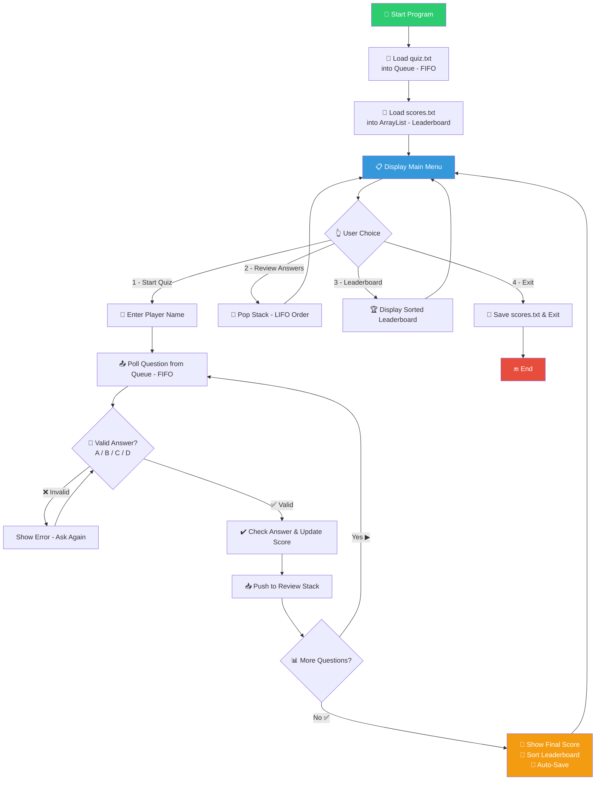
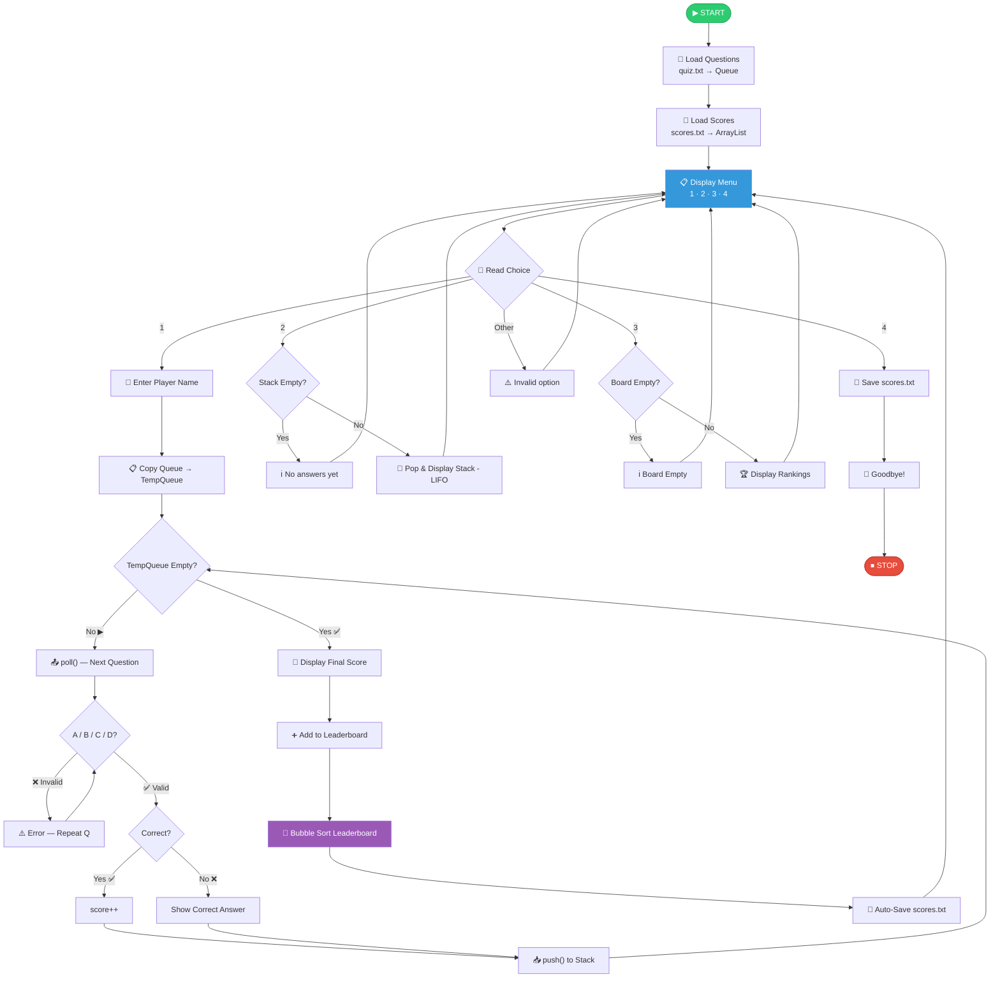
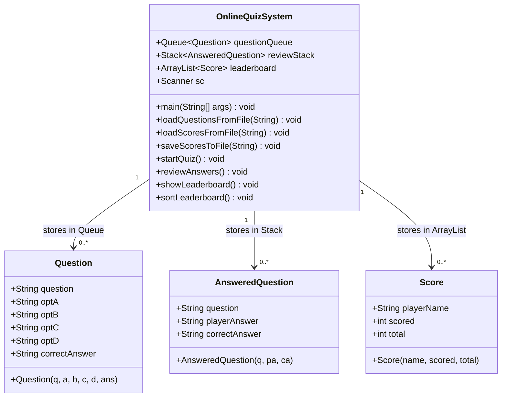
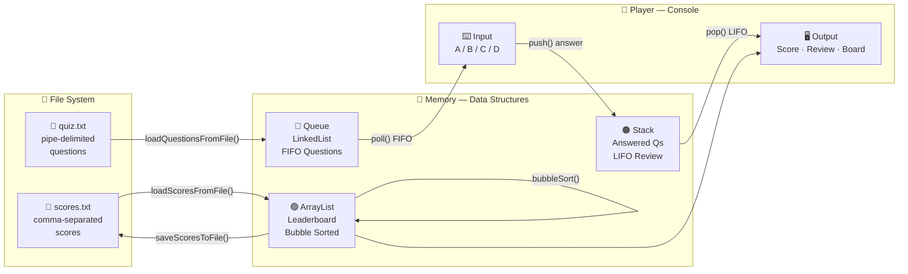

<!-- ═══════════════════════════════════════════════════════════════ -->
<!--                   ONLINE QUIZ SYSTEM — README                   -->
<!-- ═══════════════════════════════════════════════════════════════ -->

<div align="center">


<br/>

<!-- University Banner -->
<table>
<tr>
<td align="center" style="background:#1a1a2e; padding:20px; border-radius:12px;">
<h2>🏛️ RUNGTA INTERNATIONAL SKILLS UNIVERSITY</h2>
<h3>🎓 School of Computer Science and Engineering</h3>
<p><i>Project No. PS-3 &nbsp;|&nbsp; Online Quiz System</i></p>
</td>
</tr>
</table>

<br/>

<!-- Badges Row 1 -->

&nbsp;

&nbsp;


<br/><br/>

<!-- Badges Row 2 -->

&nbsp;

&nbsp;


<br/><br/>

<!-- Quick Project Links -->
<h3>🔗 Project Documentation &amp; Presentation</h3>

<a href="https://docs.google.com/document/d/13XEb9ckAF55vdpyuANC-45WkCU2Sa9ARc9OduFWfBJ0/edit?usp=sharing" target="_blank">
  
</a>
&nbsp;&nbsp;
<a href="https://docs.google.com/presentation/d/1FQLAky3JaWfRf2OJggCwb5QIze7bsqUptBS44iT4Z2Y/edit?usp=sharing" target="_blank">
  
</a>

<br/><br/>

</div>

---

## 📌 Table of Contents

<div align="center">

| 📂 Section | 🔗 Jump To |
|:---:|:---:|
| 📖 Project Info | [Project Description](#-project-description) |
| 🎯 Problem Statement | [Problem Statement](#-problem-statement) |
| 🧠 Data Structures | [Data Structures Used](#-data-structures-used) |
| 🏗️ Architecture | [System Architecture](#-system-architecture) |
| 📊 Flowchart | [Flowchart](#-program-flowchart) |
| 📐 Class Diagram | [Class Diagram](#-class-diagram) |
| 🔄 Data Flow | [Data Flow Diagram](#-data-flow-diagram) |
| ✨ Features | [Features](#-features) |
| 📄 File Formats | [File Formats](#-file-formats) |
| 🧪 Test Cases | [Test Cases](#-test-cases) |
| 🚀 How to Run | [How to Run](#-how-to-run) |
| 📁 Structure | [Project Structure](#-project-structure) |
| 🖥️ Sample Output | [Sample Output](#%EF%B8%8F-sample-output) |
| ✅ Requirements | [Requirements Met](#-requirements-met) |
| 👨‍💻 Author | [Author](#-author) |

</div>

---

## 📖 Project Description

<div align="center">

<table>
<thead>
<tr>
<th>🏷️ Field</th>
<th>📋 Details</th>
</tr>
</thead>
<tbody>
<tr><td><b>PS No.</b></td><td>3</td></tr>
<tr><td><b>Project Title</b></td><td>Online Quiz System</td></tr>
<tr><td><b>Language</b></td><td>☕ Java (Single <code>.java</code> file)</td></tr>
<tr><td><b>Key Concepts</b></td><td>Queue · Stack · Array · Sorting · Methods · File Handling</td></tr>
<tr><td><b>Question File</b></td><td><code>quiz.txt</code> (3 questions)</td></tr>
<tr><td><b>Score File</b></td><td><code>scores.txt</code> (auto-saved)</td></tr>
<tr><td><b>Answer Key</b></td><td>Q1-B, Q2-A, Q3-C</td></tr>
<tr><td><b>Institution</b></td><td>Rungta International Skills University</td></tr>
</tbody>
</table>

</div>

> **Summary:** A console quiz application where questions load from a file into a **Queue**, answered questions are pushed onto a **Stack** for review (latest first), and scores are saved to a leaderboard sorted in descending order.

---

## 🎯 Problem Statement

<div align="center">
<table>
<tr>
<td>

> 💬 *Develop a console quiz application. Questions are loaded from a file into a **queue** and asked one by one. Answered questions are pushed on a **stack** so the player can review them (latest first). Scores are saved and shown on a leaderboard sorted by score.*

</td>
</tr>
</table>
</div>

<br/>

<div align="center">

| 🔑 Concept | 🛠️ How It's Used |
|:---:|:---|
| **Queue** | Stores questions from `quiz.txt` in FIFO order — asked one by one |
| **Stack** | Stores answered questions in LIFO order — latest answer reviewed first |
| **Array / ArrayList** | Holds leaderboard score entries |
| **Sorting** | Bubble Sort arranges leaderboard by score (descending) |
| **Methods** | Modular design — each feature has its own method |
| **File Handling** | `BufferedReader` reads `quiz.txt`; `BufferedWriter` saves `scores.txt` |

</div>

---

## 🧠 Data Structures Used

### 🔵 1. Queue — Question Bank (FIFO)

```
  quiz.txt ──► ENQUEUE ──────────────────────────────────► DEQUEUE ──► Player
               ┌────────┬────────┬────────┐
               │   Q1   │   Q2   │   Q3   │
               │        │        │        │   poll() ──► asks Q1 first
               └────────┴────────┴────────┘
               FRONT                  REAR
               (First In, First Out)
```

<div align="center">

| Method | Action |
|--------|--------|
| `add(question)` | Load question from file into queue |
| `poll()` | Fetch next question (removes from front) |
| `isEmpty()` | Check if quiz is complete |

</div>

---

### 🟠 2. Stack — Answer Review (LIFO)

```
  After Quiz:                   Review Order:
  ┌─────────────────┐           ← pop() Q3 first
  │   Q3 answer  ◄──┤ TOP       ← pop() Q2 second
  ├─────────────────┤           ← pop() Q1 last
  │   Q2 answer     │
  ├─────────────────┤
  │   Q1 answer     │  BOTTOM
  └─────────────────┘
  (Last In, First Out)
```

<div align="center">

| Method | Action |
|--------|--------|
| `push(answeredQ)` | Store answer after each question |
| `pop()` | Retrieve latest answer first |
| `isEmpty()` | Check if any answers exist |

</div>

---

### 🟢 3. ArrayList + Bubble Sort — Leaderboard

```
  After 3 players:                   After bubbleSort():
  ┌──────────────────┐               ┌──────────────────┐
  │  Aman   → 2/3    │               │  Riya   → 3/3  🥇│
  │  Riya   → 3/3    │  ──sort()──►  │  Aman   → 2/3  🥈│
  │  Jay    → 1/3    │               │  Jay    → 1/3  🥉│
  └──────────────────┘               └──────────────────┘
  Unsorted                           Descending by score
```

---

## 🏗️ System Architecture



---

## 📊 Program Flowchart



---

## 📐 Class Diagram



---

## 🔄 Data Flow Diagram



---

## ✨ Features

<div align="center">

<table>
<thead>
<tr>
<th>🔧 Feature</th>
<th>📝 Description</th>
<th>🧠 DSA Concept</th>
</tr>
</thead>
<tbody>
<tr>
<td>📂 <b>Load Questions</b></td>
<td>Reads <code>quiz.txt</code> (pipe-delimited) into question bank on startup</td>
<td><code>Queue&lt;Question&gt;</code> — LinkedList</td>
</tr>
<tr>
<td>❓ <b>Start Quiz</b></td>
<td>Asks questions in order; re-asks same question on invalid input</td>
<td><code>Queue.poll()</code> — FIFO</td>
</tr>
<tr>
<td>📥 <b>Review Answers</b></td>
<td>Shows all answers latest-first after any quiz session</td>
<td><code>Stack.pop()</code> — LIFO</td>
</tr>
<tr>
<td>🏆 <b>Leaderboard</b></td>
<td>Displays all-time rankings sorted highest score first</td>
<td><code>ArrayList</code> + Bubble Sort</td>
</tr>
<tr>
<td>💾 <b>Persistence</b></td>
<td>Scores auto-saved after every quiz; reloaded next run</td>
<td>File I/O — BufferedWriter</td>
</tr>
<tr>
<td>🔁 <b>Input Validation</b></td>
<td>Re-asks same question until A, B, C or D is entered</td>
<td>While-loop guard</td>
</tr>
<tr>
<td>📊 <b>Score Display</b></td>
<td>Shows <code>name scored X/Y</code> at end of every quiz</td>
<td>Scoring counter</td>
</tr>
</tbody>
</table>

</div>

---

## 📄 File Formats

### 📝 `quiz.txt` — Question Bank

<div align="center">

**Format per line:**

</div>

```
question|optionA|optionB|optionC|optionD|correctAnswer
```

<div align="center">

**Actual file contents:**

</div>

```
What is the capital of France?|A) Berlin|B) Paris|C) Rome|D) Madrid|B
Which data structure uses FIFO order?|A) Queue|B) Stack|C) Tree|D) Graph|A
What does JVM stand for?|A) Java Virtual Memory|B) Java Version Manager|C) Java Virtual Machine|D) Java Variable Method|C
```

> **💡 Tip:** Correct answer is the **letter only** (A, B, C, or D). The system automatically converts to uppercase on load.

<br/>

### 📝 `scores.txt` — Persistent Leaderboard

<div align="center">

**Format per line:**

</div>

```
playerName,scored,total
```

<div align="center">

**Example contents:**

</div>

```
Riya,3,3
Aman,2,3
Jay,1,3
```

> **💡 Tip:** This file is auto-generated. Scores persist across all sessions and are reloaded on startup.

---

## 🧪 Test Cases

<div align="center">

### ✅ Test Case 1 — Normal Input

<table>
<thead>
<tr><th>Step</th><th>Input</th><th>Expected Output</th></tr>
</thead>
<tbody>
<tr><td>Menu</td><td><code>1</code> (Start quiz)</td><td>Prompts for player name</td></tr>
<tr><td>Player</td><td><code>Riya</code></td><td>Shows Q1</td></tr>
<tr><td>Q1</td><td><code>B</code></td><td>Correct ✅ — shows Q2</td></tr>
<tr><td>Q2</td><td><code>A</code></td><td>Correct ✅ — shows Q3</td></tr>
<tr><td>Q3</td><td><code>C</code></td><td>Correct ✅ — quiz ends</td></tr>
<tr><td colspan="2"><b>Result</b></td><td>✅ <code>Quiz over. Riya scored 3/3.</code></td></tr>
</tbody>
</table>

---

### ⚠️ Test Case 2 — Boundary / Minimum Input

<table>
<thead>
<tr><th>Condition</th><th>Input</th><th>Expected Output</th></tr>
</thead>
<tbody>
<tr><td>Only Q1 in bank</td><td>Player: <code>Aman</code></td><td>Shows Q1 only</td></tr>
<tr><td>Wrong answer</td><td><code>D</code></td><td><code>Wrong! Correct answer: B</code></td></tr>
<tr><td colspan="2"><b>Result</b></td><td>⚠️ <code>Quiz over. Aman scored 0/1.</code></td></tr>
</tbody>
</table>

---

### ❌ Test Case 3 — Invalid Input

<table>
<thead>
<tr><th>Step</th><th>Input</th><th>Expected Output</th></tr>
</thead>
<tbody>
<tr><td>Menu → Q1 shown</td><td><code>1</code></td><td>Q1 displayed</td></tr>
<tr><td>Answer</td><td><code>E</code></td><td>❌ <code>Invalid option. Enter A, B, C or D.</code></td></tr>
<tr><td>System re-asks</td><td>—</td><td>Q1 is shown <b>again</b> (not counted)</td></tr>
</tbody>
</table>

---

### 🔁 Test Case 4 — Different Valid Scenario

<table>
<thead>
<tr><th>Scenario</th><th>Action</th><th>Expected Output</th></tr>
</thead>
<tbody>
<tr><td>Riya 3/3 previously</td><td>Aman starts quiz</td><td>Quiz runs normally</td></tr>
<tr><td>Aman: B, A, D</td><td>Answers submitted</td><td>Q3 wrong — shown correct</td></tr>
<tr><td>Aman 2/3</td><td>Select Review (2)</td><td>Q3 | A: D | Correct: C</td></tr>
<tr><td></td><td></td><td>Q2 | A: A | Correct: A</td></tr>
<tr><td></td><td></td><td>Q1 | A: B | Correct: B</td></tr>
<tr><td>Select Leaderboard (3)</td><td></td><td>1. Riya - 3/3 🥇</td></tr>
<tr><td></td><td></td><td>2. Aman - 2/3 🥈</td></tr>
</tbody>
</table>

</div>

---

## 🚀 How to Run

### 📋 Prerequisites

<div align="center">

| Requirement | Detail |
|:-----------:|:------:|
| ☕ Java JDK | Version 8 or later |
| 📄 quiz.txt | Must be in same folder as the `.class` file |
| 💻 Terminal | Command Prompt / PowerShell / Terminal |

</div>

### ⚡ Step-by-Step Commands

```bash
# Step 1 — Navigate to the project folder
cd "Java Project"

# Step 2 — Compile the source file
javac OnlineQuizSystem.java

# Step 3 — Run the program
java OnlineQuizSystem
```

### 🖥️ Expected Startup

```
Questions loaded: 3
=============================
    Welcome to Quiz System   
=============================

--- MENU ---
1. Start Quiz
2. Review Last Answers
3. Leaderboard
4. Exit
Choose option: 
```

> **⚠️ Important:** `quiz.txt` must be in the **same directory** where you run `java OnlineQuizSystem`. The program prints a warning and exits gracefully if it's missing.

---

## 📁 Project Structure

```
📦 Java Project/
│
├── 📄 OnlineQuizSystem.java      ← Single main source file
│   │
│   ├── 🔷 class Question              (question data model)
│   │       ├── String question
│   │       ├── String optA/B/C/D
│   │       └── String correctAnswer
│   │
│   ├── 🔶 class AnsweredQuestion      (review stack model)
│   │       ├── String question
│   │       ├── String playerAnswer
│   │       └── String correctAnswer
│   │
│   ├── 🟢 class Score                 (leaderboard model)
│   │       ├── String playerName
│   │       ├── int scored
│   │       └── int total
│   │
│   └── 🔵 class OnlineQuizSystem      (main logic + entry point)
│           ├── Queue<Question>         questionQueue
│           ├── Stack<AnsweredQuestion> reviewStack
│           ├── ArrayList<Score>        leaderboard
│           └── 7 methods
│
├── 📝 quiz.txt                   ← Question bank (3 questions, pipe-delimited)
├── 💾 scores.txt                 ← Auto-generated score persistence
└── 📖 README.md                  ← This file
```

---

## 🖥️ Sample Output

<details>
<summary>▶️ <b>Click to expand — Start Quiz</b></summary>

```
--- MENU ---
1. Start Quiz
2. Review Last Answers
3. Leaderboard
4. Exit
Choose option: 1

Enter your name: Riya

Q1: What is the capital of France?
  A) Berlin
  B) Paris
  C) Rome
  D) Madrid
Your answer (A/B/C/D): B

Q2: Which data structure uses FIFO order?
  A) Queue
  B) Stack
  C) Tree
  D) Graph
Your answer (A/B/C/D): A

Q3: What does JVM stand for?
  A) Java Virtual Memory
  B) Java Version Manager
  C) Java Virtual Machine
  D) Java Variable Method
Your answer (A/B/C/D): C

Quiz over. Riya scored 3/3.
```

</details>

<details>
<summary>📖 <b>Click to expand — Review Answers</b></summary>

```
--- Review (Latest First) ---
Q3 | Your answer: C | Correct: C
Q2 | Your answer: A | Correct: A
Q1 | Your answer: B | Correct: B
```

</details>

<details>
<summary>🏆 <b>Click to expand — Leaderboard</b></summary>

```
--- Leaderboard ---
1. Riya - 3/3
2. Aman - 2/3
3. Jay  - 1/3
```

</details>

<details>
<summary>❌ <b>Click to expand — Invalid Input Guard</b></summary>

```
Q1: What is the capital of France?
  A) Berlin
  B) Paris
  C) Rome
  D) Madrid
Your answer (A/B/C/D): E
Invalid option. Enter A, B, C or D.

Q1: What is the capital of France?
  A) Berlin
  B) Paris
  C) Rome
  D) Madrid
Your answer (A/B/C/D): 
```

</details>

---

## ✅ Requirements Met

<div align="center">

### 📌 Bare Minimum Requirements

<table>
<thead>
<tr><th>Requirement</th><th>Status</th></tr>
</thead>
<tbody>
<tr><td>Write solution in Java — Main class in one <code>.java</code> file, run from console</td><td>✅ Done</td></tr>
<tr><td>Store questions in a <b>Queue</b> and answered questions on a <b>Stack</b></td><td>✅ Done</td></tr>
<tr><td>Provide <b>start quiz</b>, <b>review</b>, and <b>leaderboard (sorted)</b> features using methods</td><td>✅ Done</td></tr>
<tr><td>Accept <b>only A, B, C or D</b> — invalid answers must not be counted</td><td>✅ Done</td></tr>
<tr><td>Load data from file at start and <b>save it on exit</b></td><td>✅ Done</td></tr>
</tbody>
</table>

<br/>

### 📌 Instructions

<table>
<thead>
<tr><th>Instruction</th><th>Status</th></tr>
</thead>
<tbody>
<tr><td>Understand the problem statement and define the problem clearly</td><td>✅ Done</td></tr>
<tr><td>Develop the solution using proper logic and programming concepts</td><td>✅ Done</td></tr>
<tr><td>Implement all required features and pass the given test cases</td><td>✅ Done</td></tr>
<tr><td>Test and debug the program to ensure correct output</td><td>✅ Done</td></tr>
<tr><td>Prepare documentation/report and upload the code to GitHub</td><td>✅ Done</td></tr>
<tr><td>Complete and submit the project within the given deadline</td><td>✅ Done</td></tr>
</tbody>
</table>

</div>

---

## 🏫 University Details

<div align="center">

<table>
<tr>
<td align="center">

| 🏷️ Field | 📋 Value |
|:---:|:---:|
| **University** | Rungta International Skills University |
| **School** | School of Computer Science and Engineering |
| **Subject** | Data Structures & Algorithms / Java Programming |
| **Project No.** | PS No. 3 |
| **Project Title** | Online Quiz System |

</td>
</tr>
</table>

</div>

---

## 👨‍💻 Author

<div align="center">

<table>
<tr>
<td align="center">


<br/>

### **Aditya Mohan**
*Student — Rungta International Skills University*
*School of Computer Science and Engineering*

<br/>

[](https://github.com/)
&nbsp;
[](https://linkedin.com/)

</td>
</tr>
</table>

</div>

---

<div align="center">


<br/>

**Made with ❤️ in Java**

`Queue` &nbsp;•&nbsp; `Stack` &nbsp;•&nbsp; `Bubble Sort` &nbsp;•&nbsp; `File I/O`

<br/>

*© 2026 Rungta International Skills University — School of Computer Science and Engineering*

</div>
